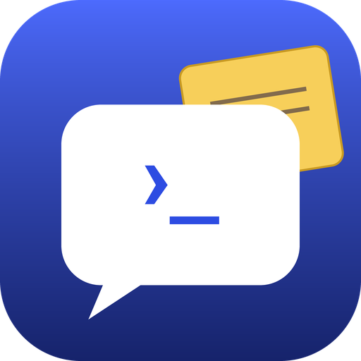
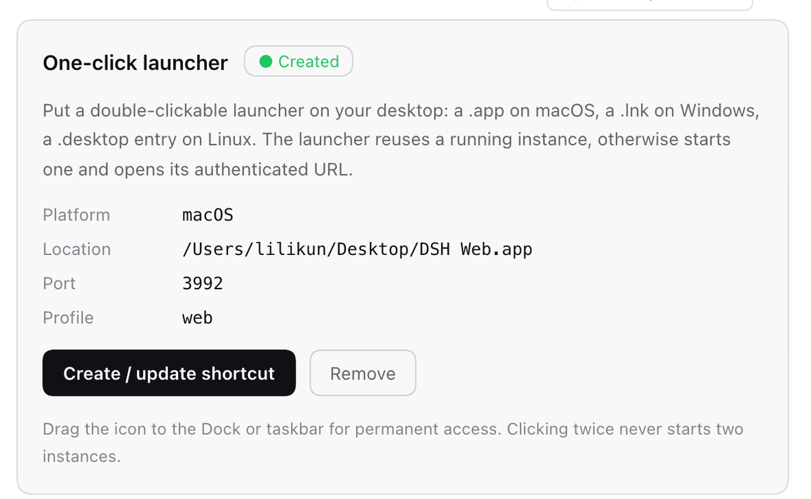

<div align="center">



# dsh-one-click-launcher

**A double-clickable desktop icon for DeepSeek Harness — macOS, Windows and Linux**

[](https://github.com/kenneth-kun/dsh-one-click-launcher)
[](LICENSE)
[](https://github.com/topics/dsh-plugin)
[](https://dsh-plugin.org/plugins/kenneth-kun/dsh-one-click-launcher)

</div>

---

## UI



<sub>The port `3992` in the screenshot belongs to the throwaway instance used for capturing it — in real use it always equals the port of the page you clicked from (usually `3080`).</sub>

## Why

`dsh web` means opening a terminal, and the printed URL carries a one-shot token that is gone as soon as the terminal closes. With this plugin:

> **Settings → Desktop shortcut → Create / update shortcut** → an icon lands on your desktop → from then on a double-click opens the GUI.

Each platform gets a native entry point, not an opaque script:

| Platform | Artifact | Notes |
| --- | --- | --- |
| macOS | `DSH Web.app` | a real app bundle with its own icon; drag it into the Dock |
| Windows | `DSH Web.lnk` | targets `wscript.exe` + a VBS shim, so no console window flashes |
| Linux | `DSH Web.desktop` | also installed into `~/.local/share/applications` for the app menu |

## What a double-click does

The generated launcher (`launcher.cjs`, zero dependencies, Node built-ins only):

1. **Probes the port** — if DSH already serves `127.0.0.1:<port>`, it does not start a second process.
2. **Reuses the login hand-off** — if the last token URL still answers `3xx`, it is used again to mint a cookie; otherwise the plain root URL is opened (a still-valid 30-day cookie lets the browser in).
3. **Cold start** — spawns `dsh <profile> --no-open --port <port>` detached, scrapes `dsh web: http://…/?token=…` from its log, saves it and opens it in the default browser.

Details that matter:

- **The port follows the page you clicked from**, so a GUI on 3081 gets a shortcut that starts 3081 and never fights your usual instance.
- **Fast double-clicks never spawn duplicates** — a file lock guards the run.
- **Failures talk back** — `osascript` on macOS, MessageBox on Windows, `zenity` on Linux, always with the log path.
- **Uninstalling the plugin does not break existing icons** — `launcher.cjs` is copied into the user's data dir, not referenced from `node_modules`.

## Install

From source (available today):

```sh
dsh plugin --profile web add github:kenneth-kun/dsh-one-click-launcher
```

From npm (once published):

```sh
dsh plugin --profile web add dsh-one-click-launcher
```

> The npm package is not published yet: dsh-plugin.org still lists the repository as-is, but it will
> not appear in the in-app Plugin Center until `npm publish` has run (see [PUBLISHING.md](PUBLISHING.md)).

Linking a local checkout:

```sh
dsh plugin --profile web add /absolute/path/to/dsh-one-click-launcher
```

Restart `dsh web` afterwards; a "Desktop shortcut" section appears in Settings.

## Use

**Settings → Desktop shortcut** shows the detected OS, the exact path the shortcut will occupy, the port and profile it will start, plus a `Created / Not created` badge.

- **Create / update shortcut** writes (or overwrites) the desktop icon — click again after changing port or profile.
- **Remove** deletes both the desktop icon and the payload under `%LOCALAPPDATA%` / `~/.local/share`.

Pin it afterwards: Dock on macOS, taskbar on Windows, app menu on Linux.

## Configuration

Every field is optional:

```yaml
- insert:
    - id: one-click-launcher
      name: dsh-one-click-launcher
      config:
        port: 3080        # port the shortcut starts; defaults to the page's port
        profile: web      # profile the shortcut boots; defaults to the host's
        appName: DSH Web  # desktop icon label
```

## Layout

```
dsh-one-click-launcher/
├── index.js              # host half: /plugins/one-click-launcher/{status,create,remove}
├── client.js             # browser half: the Settings section (zh/en)
├── cordis.patch.yml      # bundle patch inserting the plugin row
├── lib/
│   ├── launcher.cjs      # the launcher copied to the user's machine
│   ├── platforms.js      # desktop/data dirs, per-platform escaping
│   ├── command.js        # resolves node + dsh bin.js + profile + port
│   └── shortcuts.js      # generates .app / .lnk+.vbs / .desktop
├── assets/               # icon.png / icon.ico / icon.icns
├── scripts/make-icons.py # maintainer-only icon renderer (Pillow)
└── test/                 # node --test, 19 cases
```

## Security & privacy

- The host binds loopback only, and all three routes enforce a **same-origin fence** (`Host` must be loopback; a missing `Origin` or a same-origin one is required; the desktop shell's `dsh-app://` protocol is whitelisted) so no other website can CSRF files onto your desktop.
- No telemetry, no network calls: the plugin writes only to the desktop, `%LOCALAPPDATA%`/`~/.local/share`, and its state directory.
- Generated shortcuts contain no API keys — credentials stay with DSH; the launcher merely points the browser at the token URL.

## Known limits

- Sessions hosted by the official desktop shell (Electron) have no `bin.js` in `argv`; the shortcut falls back to the `dsh` command, so `dsh` must be on `PATH` there.
- The shortcut starts and opens the GUI; it does not register a login item / autostart.
- If Windows policy blocks PowerShell's `WScript.Shell`, the plugin falls back to a desktop `.cmd` (same behaviour, one console flash).

## Development

```sh
npm test          # node --test test/*.test.js — generation + launcher runtime
npm run icons     # re-render assets/ (Python 3 + Pillow)
```

## Publishing

See [PUBLISHING.md](PUBLISHING.md) — npm publish, GitHub `dsh-plugin` topic, submit on dsh-plugin.org.

## License

[MIT](LICENSE)
