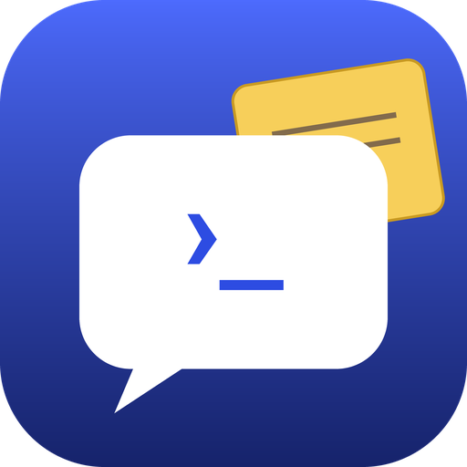
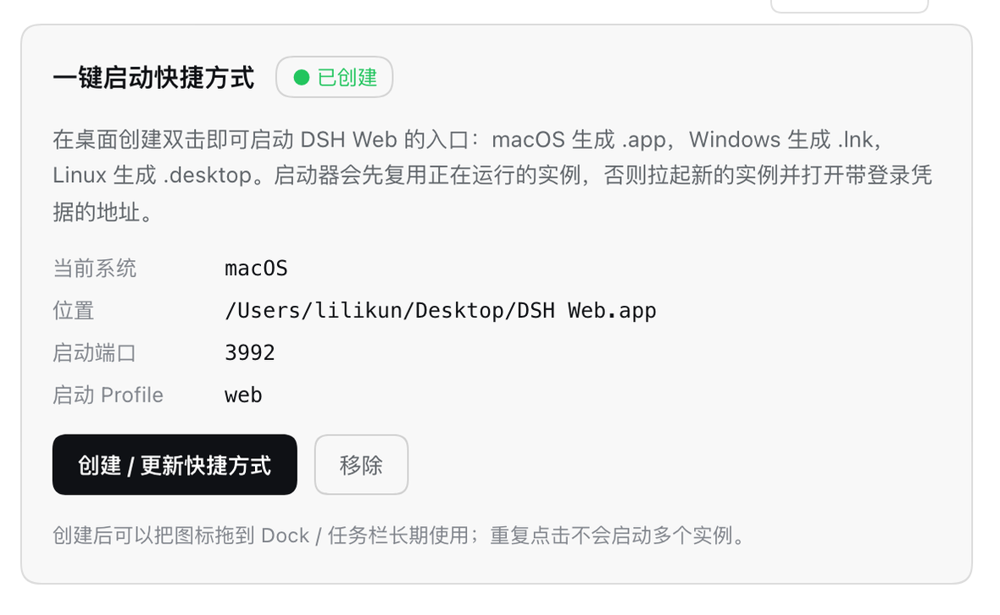

<div align="center">



# dsh-one-click-launcher

**给 DeepSeek Harness 做一个双击就跑的桌面图标 · macOS / Windows / Linux 三平台通用**

[](https://www.npmjs.com/package/dsh-one-click-launcher)
[](https://github.com/kenneth-kun/dsh-one-click-launcher)
[](LICENSE)
[](https://github.com/topics/dsh-plugin)
[](https://dsh-plugin.org/plugins/kenneth-kun/dsh-one-click-launcher)

</div>

---

## 界面



<sub>截图里的端口 `3992` 是专门用来截图的实例；实际使用时它永远等于你当前页面的端口（通常是 `3080`）。</sub>

## 这个插件解决什么问题

`dsh web` 每次都要开终端敲命令，地址里还带一次性 token，退出终端就找不回来。装上这个小插件后：

> **设置 → 桌面快捷方式 → 创建 / 更新快捷方式** → 桌面出现一个图标 → 以后双击它就进 GUI。

三平台都会生成"原生"入口，而不是一个没人看得懂的脚本：

| 系统 | 桌面产物 | 说明 |
| --- | --- | --- |
| macOS | `DSH Web.app` | 真正的 app bundle，有自己的图标，可拖进 Dock |
| Windows | `DSH Web.lnk` | 快捷方式指向 `wscript.exe` + VBS 垫片，启动时不闪黑框 |
| Linux | `DSH Web.desktop` | 同时写入 `~/.local/share/applications`，应用菜单里也能搜到 |

## 双击之后发生了什么

生成的启动器（`launcher.cjs`，零依赖，纯 Node 内置模块）按顺序做三件事：

1. **先看端口**：`127.0.0.1:<端口>` 已经有 DSH 在服务 → 不重复起进程。
2. **复用登录态**：上次成功换取 cookie 的带 token 地址仍然返回 `3xx` 就直接用它重新登录；否则退回根地址（浏览器里已有 30 天有效 cookie 时同样能进）。
3. **冷启动**：后台执行 `dsh <profile> --no-open --port <端口>`，从它的日志里抓出 `dsh web: http://…/?token=…`，写进状态文件并用默认浏览器打开。

几个细节：

- **端口跟随当前页面**：在 3081 打开的 GUI，生成的快捷方式就启动 3081，不会和平常使用的实例打架。
- **快速连点不会起多个实例**：启动器有文件锁，第二次点击直接复用。
- **启动失败会说话**：macOS 弹 `osascript` 提示、Windows 弹 MessageBox、Linux 走 `zenity`，并附上日志路径。
- **插件卸载也不影响已创建的图标**：`launcher.cjs` 是复制到用户目录的，不依赖插件的 `node_modules`。

## 安装

### 从 npm 安装（推荐，已发布 0.1.0）

```sh
dsh plugin --profile web add dsh-one-click-launcher
```

也可以在 **设置 → 插件市场**（[dsh-plugin.org](https://dsh-plugin.org/plugins/kenneth-kun/dsh-one-click-launcher)）里搜 `dsh-one-click-launcher` 一键安装。

### 从 GitHub 源码安装

```sh
dsh plugin --profile web add github:kenneth-kun/dsh-one-click-launcher
```

### 本地开发

```sh
dsh plugin --profile web add /absolute/path/to/dsh-one-click-launcher
```

装完重启 `dsh web`（或在插件市场里按提示刷新），设置里会出现「桌面快捷方式」一栏。

## 使用

打开 **设置 → 桌面快捷方式**，页面会显示：当前系统、快捷方式将要落到的完整路径、启动端口、启动 profile，以及 `已创建 / 未创建` 状态。

- **创建 / 更新快捷方式**：写入（或覆盖）桌面图标。重复点击等于重建，换端口、换 profile 后点一次即可同步。
- **移除**：同时清掉桌面图标和 `%LOCALAPPDATA%` / `~/.local/share` 下的启动载荷。

> 想让它更"正式"：macOS 把图标拖进 Dock，Windows 右键"固定到任务栏"，Linux 直接从应用菜单启动。

## 配置

`cordis.patch.yml` 里的行支持三个可选字段（默认值即可用）：

```yaml
- insert:
    - id: one-click-launcher
      name: dsh-one-click-launcher
      config:
        port: 3080        # 快捷方式启动的端口；默认跟随创建时页面所在端口
        profile: web      # 快捷方式启动的 profile；默认跟随当前宿主
        appName: DSH Web  # 桌面图标显示的名字
```

## 目录结构

```
dsh-one-click-launcher/
├── index.js              # 宿主半：/plugins/one-click-launcher/{status,create,remove}
├── client.js             # 浏览器半：设置页里的「桌面快捷方式」一节（中/英）
├── cordis.patch.yml      # bundle patch：把插件行插进 profile
├── lib/
│   ├── launcher.cjs      # 复制到用户机的启动器（零依赖，三平台同一份）
│   ├── platforms.js      # 桌面目录 / 数据目录 / 各平台转义
│   ├── command.js        # 解析 node + dsh bin.js + profile + 端口
│   └── shortcuts.js      # 生成 .app / .lnk+.vbs / .desktop
├── assets/               # icon.png / icon.ico / icon.icns
├── scripts/make-icons.py # 维护者用的图标渲染脚本（Pillow）
└── test/                 # node --test，19 个用例
```

## 安全与隐私

- 宿主只监听回环地址；三个路由都做了 **同源校验**（`Host` 必须是回环，`Origin` 缺失或同源才放行，桌面壳的 `dsh-app://` 单独白名单），防止别的网页通过 CSRF 在你的桌面塞文件。
- 没有遥测、没有联网请求；插件只写桌面、`%LOCALAPPDATA%`/`~/.local/share`、状态目录这三处。
- 生成的快捷方式里不含任何 API key —— 凭证仍由 DSH 自己管理，launcher 只是把浏览器带到带 token 的地址。

## 已知限制

- 官方桌面壳（Electron 托管宿主）启动的会话，`argv` 里没有 `bin.js`，生成的快捷方式会退回 `dsh` 命令；如果你机器上的 `dsh` 不在 PATH 里，需要在终端里手动跑一次并把它加进 PATH。
- 快捷方式只负责"启动并打开 GUI"，不负责把宿主进程设为开机自启。
- Windows 上若系统策略禁用 PowerShell 的 `WScript.Shell`，会退回桌面 `.cmd`（功能相同，启动时会有一次命令行窗口一闪）。

## 开发

```sh
npm test          # node --test test/*.test.js —— 生成逻辑 + 启动器运行时
npm run icons     # 重新渲染 assets/ 里的图标（需要 Python 3 + Pillow）
```

测试覆盖：三平台产物结构与内容、转义、`.lnk` 生成脚本、冷启动抓 token、复用 token、状态目录不可写、非法配置等。

## 发布

见 [PUBLISHING.md](PUBLISHING.md)（npm 发布 → GitHub 打 `dsh-plugin` topic → 提交到 dsh-plugin.org 收录）。

## License

[MIT](LICENSE)
